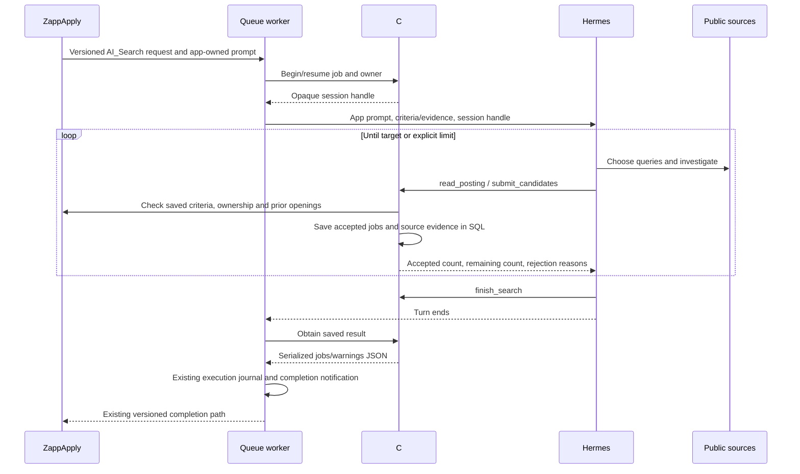

# ZappApplyAgentTools

A shared home for ZappApply agent tools. Job search is the first tool module; future tools can be added alongside it.

Hermes remains the agent and uses its existing web-search tools. This separate C# MCP service provides four controlled tools:

| Tool | Responsibility |
| --- | --- |
| `read_posting` | Retrieve a public posting and persist its source evidence. |
| `submit_candidates` | Validate sourced candidates against the app's saved user criteria and previous jobs; persist accepted jobs immediately. |
| `get_search_progress` | Return accepted/remaining counts, limits, and recent rejection reasons. |
| `finish_search` | Finish a full batch or record an honest partial search. Premature completion leaves the search running. |

The service does not select search queries or call a model. All behavioral instructions belong to the app's **System Prompts** store, editable in Admin. Queue code forwards those instructions, starts/resumes the tool session, and obtains the final C#-serialized result. The model cannot deliver a narrative or file path in place of accepted jobs.



Run checks without AI or external websites:

```powershell
dotnet run --project tests/ZappApplyAgentTools.Checks
# Also exercise real SQL transactions in a disposable LocalDB database:
dotnet run --project tests/ZappApplyAgentTools.Checks -- --localdb
```

See [deployment instructions](docs/Deployment.md). The website rollout flag defaults to **false**. This repository does not deploy itself or alter Hermes configuration.

## Practical limits

- Default target: 10; default limits: 100 state-changing tool calls and 30 minutes. Hermes web-search calls are governed by Hermes's own limits, not this tool counter.
- A model can still stop prematurely or fail. Accepted jobs remain saved, and final output reports a partial result; the queue never blindly repeats AI work to hide the failure.
- `sources_exhausted` is an agent-reported limitation, not proof that every possible site was searched.
- The reader supports public HTML, JobPosting JSON-LD, JSON, and plain text. It does not execute JavaScript, sign in, bypass blocks, or access private networks. Some sites therefore remain unreadable. Source checks prevent invented titles/descriptions/pay; they are not a full independent semantic fact-check of every optional field.
- Models still interpret optional metadata. Existing app criteria rules determine acceptance; this service does not introduce another matching-rule system.
- Accepted jobs are persisted during the search; the existing website completion handler displays/applies them when the search finishes. This does not add live UI streaming.
- Internal requests require separate service keys, plus an opaque per-search capability for MCP calls. Never expose the control or MCP endpoint publicly or log its Authorization header. Rotate keys only after active searches drain.
- Keep evidence retention for at least the job lifetime. Production retention/cleanup policies should be part of the planned architecture audit.

Deploy from GitHub using the [self-hosted runner workflow](docs/GitHub-deployment.md). The first manual deployment can initialize the SQL tables; normal pushes deploy without schema initialization.
